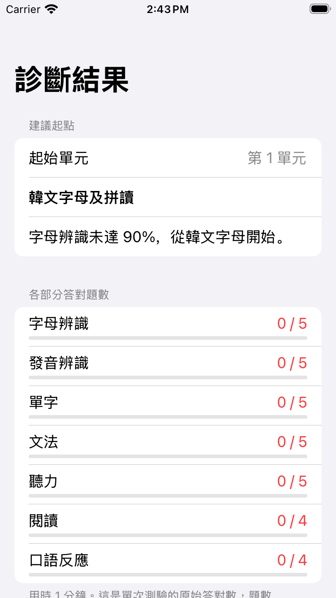
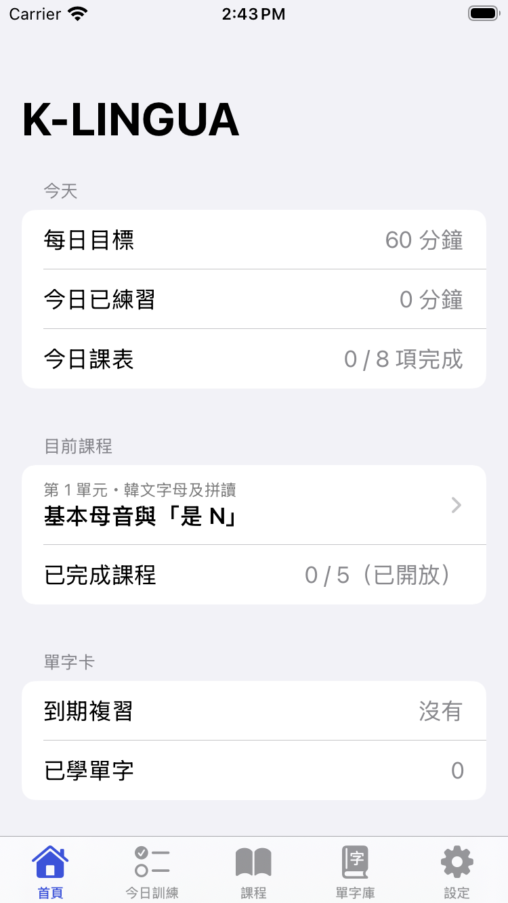
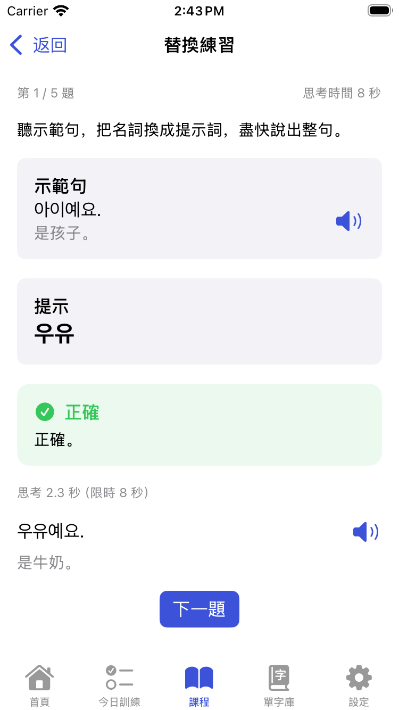
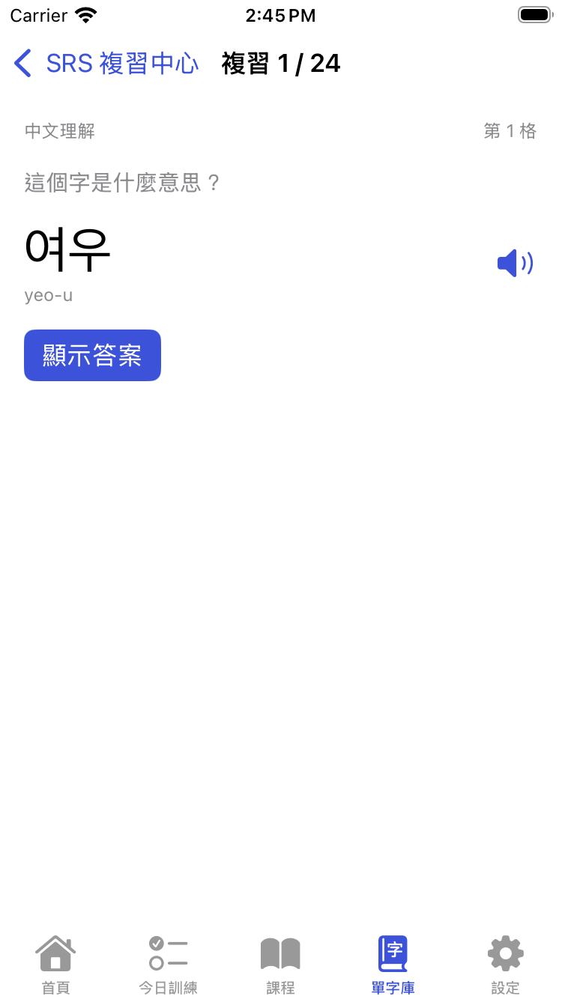
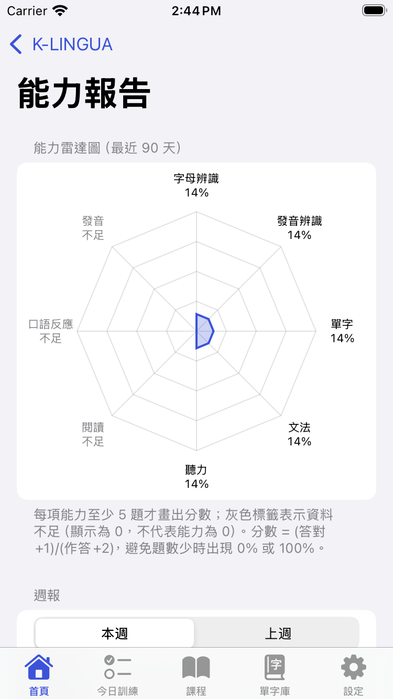

# 第五階段：整合測試報告

測試日期：2026-11-20
測試環境：GitHub Actions `macos-15`、Xcode 16.4、iOS 模擬器（iPhone，375×667 小螢幕機型）
最後一次全部通過的 CI：run 44755630746（commit「SRS: show new facets easiest first」）

## 結果總覽

| 層級 | 內容 | 數量 | 結果 |
|---|---|---|---|
| 核心單元測試 | KLinguaCore（SRS、Hangul、Drill 評分、課表、診斷、語音比對、AI 請求格式、週報…） | 88 | ✅ 全部通過 |
| App 整合測試 | StudyStore + SwiftData（記憶體資料庫）+ 內建教材 + 鑰匙圈，在模擬器內執行 | 15 | ✅ 全部通過 |
| UI 端對端測試 | XCUITest 在模擬器上實際點擊、輸入、換頁 | 4 | ✅ 全部通過 |
| 編譯 | 模擬器 Debug、實機 Release（未簽章） | 2 | ✅ 成功 |

## UI 端對端測試涵蓋的流程

| 測試 | 實際操作 | 驗證 |
|---|---|---|
| 診斷測驗 | 首次啟動 → 開始診斷 → 33 題全部按「不知道」→ 依結果開始 | 起點為第 1 單元；進入主畫面；首頁顯示第一課 |
| Pattern Drill | 課程 → 第一課 → 替換練習 → 用鍵盤輸入韓文「우유예요.」→ 其餘按「不會」 | 正確答案判為正確；結果「答對 1 / 5」；回到列表顯示正確率 20%（已寫入資料庫） |
| 單字測驗 → SRS | 單字記憶測驗 6 題 → 單字庫 → SRS 複習中心 → 開始複習 | 6 個單字加入單字卡；24 個面向到期；第一張是「中文理解」 |
| 分頁與離線 | 今日訓練、設定、能力報告、AI 情境對話 | 沒有 API Key 時課表不排 AI 對話、改排情境角色扮演；設定顯示未設定；雷達圖顯示；情境頁提示需要設定 |

## App 整合測試涵蓋的項目

- 全新安裝需要診斷；零基礎診斷 → 第一課、33 筆作答紀錄成為能力證據
- 診斷建議的單元尚未開放時，停在已開放的最後一課，且**這一課不會被標成已跳過**
- 新單字建立四個面向、立即到期、不重複引入
- 複習：流暢答對升格、忘記回第一格並記錄遺忘次數
- 課程完成：三項條件（課後測驗、句型正確率、單字測驗）缺一不可；完成後前進到下一課；最佳成績保留
- 錯誤本：助詞錯誤記錄使用者原答案，可標記已掌握
- 每日課表：10／20／60 分鐘總和正確、沒有 AI 時不排 AI 對話
- 每日紀錄累計時間、新單字、複習數
- 發音紀錄計入「發音」能力，標示辨識方式
- AI：沒有金鑰時保持關閉；金鑰寫入、讀出、刪除鑰匙圈；**金鑰不會出現在資料庫**
- AI 對話：訊息順序、修正加入錯誤本、計入口說能力
- 週報數字與資料庫中的紀錄一致

## 測試中發現並修正的問題

| 問題 | 如何發現 | 修正 |
|---|---|---|
| 診斷建議的單元還沒開放時，目前所在的課被標成「已跳過」 | 設計整合測試時檢查流程 | 只跳過起始課程之前的課，並加測試 |
| 首次安裝時 SwiftData 記錄一長串 Core Data 錯誤（Application Support 資料夾不存在） | 模擬器執行紀錄 | 建立資料庫前先建立資料夾；之後的紀錄已無此錯誤 |
| 從未複習過的新單字，第一張卡可能是最難的「口語輸出」 | 模擬器截圖 | 新面向依「中文理解 → 韓文辨識 → 聽力 → 口語」排序，加單元測試與 UI 驗證 |
| 結構檢查工具把字串中的網址當成註解，誤報括號不平衡 | 第四階段 CI | 改為逐字解析字串 |
| UI 測試：小螢幕時按鈕在畫面外、返回鍵選錯、清單停在底部 | UI 測試失敗截圖與畫面階層 | 測試改為雙向捲動尋找、指定返回鍵（屬測試程式問題，非 App 問題） |

## 截圖（模擬器實際畫面）

`Docs/screenshots/` 內有 17 張由 UI 測試自動擷取的截圖，例如：

| 診斷結果 | 首頁 | Drill 回饋 | SRS 複習 | 能力報告 |
|---|---|---|---|---|
|  |  |  |  |  |

## 沒有測到的部分（需要 iPhone 實機或 API Key）

| 項目 | 原因 |
|---|---|
| 麥克風錄音、語音辨識、說話偵測、自動停止 | 模擬器沒有真實麥克風；UI 測試刻意使用鍵盤模式 |
| 發音比對的實際辨識品質 | 需要真人在實機上說話 |
| 韓語語音（TTS）的聲音品質 | 模擬器的語音與實機不同，且沒有人耳確認 |
| Claude／OpenAI／Gemini 真實連線 | 需要你的 API Key；請求格式與回應解析已用攔截網路的測試驗證 |
| 通知提醒 | 尚未實作（不在目前範圍） |
| 長期使用（數週）的 SRS 間隔與週報 | 只能用測試資料模擬時間 |
| 不同 iPhone 尺寸、深色模式、動態字級 | 只測了一種小螢幕機型的淺色模式 |

## 如何重跑

推送到 GitHub 後自動執行。也可在 Mac 上：

```
xcodebuild test -project KLingua.xcodeproj -scheme KLingua -destination 'platform=iOS Simulator,name=iPhone 16'
```

截圖會在 CI 的 `app-test-results` 成品中（`screenshots/` 資料夾）。
