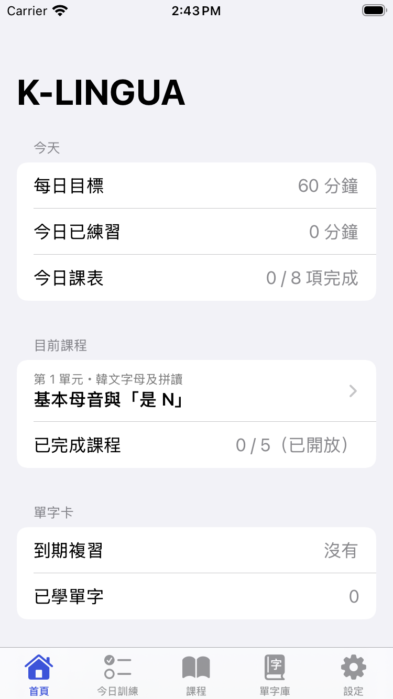
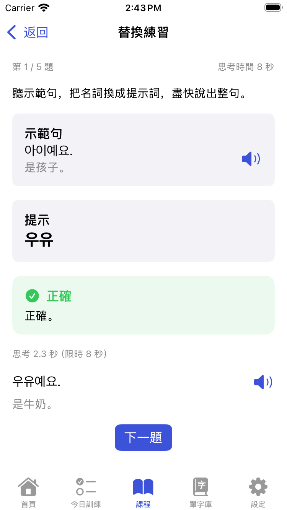
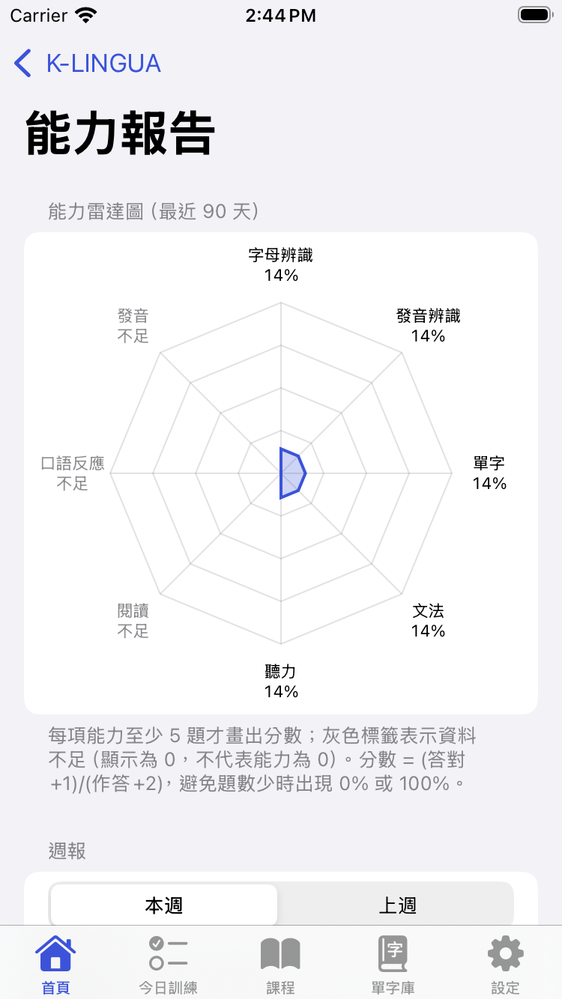

# K-LINGUA AI — 個人化韓語特訓系統（iOS）

原生 iOS App（Swift 6 / SwiftUI / SwiftData），以 FSI Pattern Drill、五格 SRS、Minimal Pairs 與 AI 情境對話為核心。

> **版本 1.0（第六階段：交付）。** 程式在 GitHub Actions 上編譯，並在 iOS 模擬器通過 88 項單元測試、15 項整合測試與 4 個 UI 流程。**教材目前開放第 1–2 單元（10 課）**；尚未在 iPhone 實機執行，麥克風、語音辨識與 AI 真實連線也還沒測過。完整現況見 [Docs/DELIVERY.md](Docs/DELIVERY.md)。

  

## 快速開始

| 我想… | 看這份 |
|---|---|
| 把 App 裝到 iPhone | [Docs/INSTALL.md](Docs/INSTALL.md)（需要 Mac + Xcode） |
| 啟用 AI 情境對話 | [Docs/API_SETUP.md](Docs/API_SETUP.md)（選用，可以不設定） |
| 了解哪些功能完成、哪些沒有 | [Docs/DELIVERY.md](Docs/DELIVERY.md) |
| 看測試結果與截圖 | [Docs/STAGE5_TEST_REPORT.md](Docs/STAGE5_TEST_REPORT.md) |

## 功能

| 區塊 | 內容 |
|---|---|
| 能力診斷 | 首次啟動 33 題，決定起始課程 |
| 課程 | 12 單元、8 階段的架構；**目前開放第 1 單元（字母及拼讀）與第 2 單元（發音及收音），共 10 課**，其餘標示「尚未開放」 |
| 每課內容 | 目標、單字、發音、文法、例句、聽力、Pattern Drill、口說、單字測驗、課後測驗、完成條件 |
| Pattern Drill | 替換／轉換／問答／自由造句；思考時間隨流暢度從 5–8 秒縮到 3 秒；錯誤分類說明 |
| SRS | 五格 Leitner；每個單字分「中文理解、韓文辨識、聽力、口語」四面向排程 |
| 語音 | ko-KR 示範發音、語音作答、開口時間偵測、發音練習（語音辨識比對）、快速反應、最小對立音 |
| AI 情境對話 | Claude／OpenAI／Gemini 任選，15 個場景、3 種語體，修正自動進錯誤本 |
| 今日訓練與報告 | 依時間與弱項排課表；8 項能力雷達圖、週報 |
| 隱私 | 學習紀錄只存在本機；API Key 只存在鑰匙圈；裝置支援時使用裝置端語音辨識 |

**發音回饋的限制**：這是「語音辨識比對」，不是發音評分。iOS 只告訴我們辨識器把聲音聽成什麼字，無法量測語調、音長、送氣強度；辨識器也會自動修正成常用詞，發音不準仍可能被辨識正確。App 不顯示任何「發音分數」。

## 目錄結構

```
k-lingua-ai/
├── KLingua.xcodeproj/          Xcode 16 專案（資料夾同步格式，新增檔案不需改 pbxproj）
├── project.yml                 XcodeGen 備援規格
├── KLingua/                    App target（SwiftUI、Apple 框架相關程式）
│   ├── App/                    @main 進入點、RootView
│   ├── Features/               各頁面：Dashboard、DailyTraining、Diagnostic、Courses、Drills、
│   │                           Quiz、Vocabulary、SRS、Pronunciation、Conversation、
│   │                           Reports、Settings、SystemCheck
│   ├── Services/               Persistence(SwiftData + StudyStore)、Speech(TTS/STT/錄音)、
│   │                           Security(Keychain)
│   ├── DesignSystem/           色彩、字級、共用元件
│   └── Resources/              Assets.xcassets（含 App 圖示）
├── Packages/KLinguaCore/       純邏輯 Swift Package（只依賴 Foundation，可獨立 swift test）
│   ├── Sources/KLinguaCore/    Domain、SRS、Curriculum、Drill、Assessment、Speech、AI、
│   │                           Analytics、Content（教材 JSON）
│   └── Tests/KLinguaCoreTests/
├── KLinguaTests/               App 整合測試（swift-testing）
├── KLinguaUITests/             模擬器 UI 測試（XCUITest）
├── Tools/validate_project.py   不需 Xcode 的結構檢查
└── Docs/                       安裝、API 設定、交付總結、測試報告、截圖
```

## 驗證狀態

每次推送都會由 GitHub Actions（macOS 15、Xcode 16.4）自動編譯與測試，見 `.github/workflows/ios-build.yml`。

| 項目 | 狀態 |
|---|---|
| 專案結構 / pbxproj 引用完整性 / JSON | ✅ `Tools/validate_project.py` |
| KLinguaCore 單元測試（88 項） | ✅ CI 上 `swift test` |
| App 整合測試（15 項，SwiftData + 教材 + 鑰匙圈） | ✅ CI 上模擬器 `xcodebuild test` |
| UI 端對端測試（4 個流程，含截圖） | ✅ CI 上模擬器 XCUITest |
| iOS App 編譯（模擬器 + 實機，未簽章） | ✅ CI 上 `xcodebuild` |
| iPhone 實機操作 | ⏳ 未測試（模擬器已通過；實機需要 Mac 與 Apple ID 安裝） |
| 麥克風、語音辨識、錄音 | ⏳ 未測試（模擬器沒有真實麥克風，必須在 iPhone 上測） |
| AI 實際連線（Claude / OpenAI / Gemini） | ⏳ 未測試（請求格式與回應解析有單元測試；真實連線需要你的 API Key，用設定頁的「測試連線」確認） |

## 授權與使用

個人學習用途的私人專案。教材內容為原創撰寫；韓語語音使用 iOS 內建語音；AI 回覆由你選擇的服務商產生，費用由你的帳戶支付。
